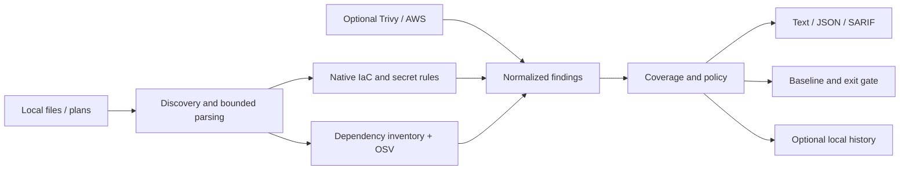

<div align="center">

# CloudSec Scanner

**Infrastructure security checks, from your terminal to your CI pipeline.**

A standalone, open-source CLI for detecting insecure infrastructure-as-code configurations, exposed secrets and vulnerable dependencies before they reach production.

[](https://github.com/sm-joe/cloudsec-scanner/releases/latest)
[](https://github.com/sm-joe/cloudsec-scanner/actions/workflows/cloudsec.yml)
[](https://github.com/sm-joe/cloudsec-scanner/actions/workflows/portability.yml)
[](#installation)
[](LICENSE)

[Quick Start](#quick-start) · [Supported Scanners](#supported-scanners) · [CI/CD](#cicd-integration) · [Documentation](#documentation) · [Releases](https://github.com/sm-joe/cloudsec-scanner/releases)

</div>

CloudSec Scanner brings targeted infrastructure and supply-chain checks into a single Python command. Scan local repositories without provisioning cloud infrastructure, review actionable findings, establish a baseline, and prevent new security regressions in CI.

No dashboard, server, database service or cloud account is required for local IaC scanning.

## Contents

- [Features](#features)
- [Installation](#installation)
- [Quick Start](#quick-start)
- [Scan Output](#scan-output)
- [Supported Scanners](#supported-scanners)
- [Configuration and Policy](#configuration-and-policy)
- [CI/CD Integration](#cicd-integration)
- [Reports and Privacy](#reports-and-privacy)
- [Architecture](#architecture)
- [Documentation](#documentation)
- [Development and Contributing](#development-and-contributing)
- [Security and License](#security-and-license)

## Features

| Capability | Description |
| --- | --- |
| IaC analysis | Structured Terraform HCL and plan JSON, selected CloudFormation, Kubernetes, Azure ARM, GCP and Dockerfile checks. |
| Secrets | Heuristic detection of selected credential patterns, with redacted evidence. |
| Dependencies | Resolved package inventory and OSV vulnerability enrichment, CVSS severity and alias deduplication. |
| Container images | Optional Trivy adapter with bounded execution and digest/scanner provenance where available. |
| Live AWS inventory | Optional read-only regional EC2, EBS, security group, RDS, ECR and EKS collection. |
| Reports | Human-readable terminal, JSON, SARIF 2.1.0 and CycloneDX 1.6 dependency inventory. |
| Security gates | Severity thresholds, baseline comparisons and narrowly scoped expiring exceptions. |
| Coverage | Evaluated, unsupported, unresolved and not-applicable resource records; incomplete scans fail closed. |
| Local history | SQLite-backed scan history, finding lifecycle and trends, with opt-out. |
| Distribution | Signed GitHub release artifacts; Linux, macOS and Windows CI on Python 3.11–3.13. |

> **Scope:** CloudSec detects selected security patterns. A clean result is not proof of security or full CIS compliance. Use additional provider-specific checks and review for production infrastructure.

## Installation

**Requirements:** Python 3.11, 3.12 or 3.13 and pip. Git is required only for source installation. The examples use Bash, including Git Bash on Windows.

### Install the stable release

[Download the latest wheel](https://github.com/sm-joe/cloudsec-scanner/releases/latest), then create an isolated environment.

```bash
# Linux / macOS
python3 -m venv .venv
source .venv/bin/activate

# Windows Git Bash — use these two commands instead:
# py -3.12 -m venv .venv
# source .venv/Scripts/activate

python -m pip install --upgrade pip
python -m pip install "https://github.com/sm-joe/cloudsec-scanner/releases/download/v0.1.0/cloudsec_scanner-0.1.0-py3-none-any.whl"
cloudsec --version
```

Version v0.1.0 includes the refreshed terminal presentation after the one-time release refresh succeeds. Existing installations of the original v0.1.0 must reinstall the wheel with `--force-reinstall --no-cache-dir`; the version number is intentionally unchanged. Verify the current release checksums before installation.

### Verify release integrity

Download the wheel, source archive, runtime SBOM and SHA256SUMS from the same release. In that directory:

```bash
sha256sum -c SHA256SUMS
gh attestation verify cloudsec_scanner-0.1.0-py3-none-any.whl \
  --repo sm-joe/cloudsec-scanner
```

Provenance verification requires the GitHub CLI. GitHub Releases is the supported distribution channel; PyPI and a prebuilt container distribution are not currently advertised.

### Install from source

```bash
git clone https://github.com/sm-joe/cloudsec-scanner.git
cd cloudsec-scanner
python -m pip install .
```

For optional AWS scanning, install the AWS extra instead:

```bash
python -m pip install '.[aws]'
```

Or install the published wheel with its AWS extra:

```bash
python -m pip install "cloudsec-scanner[aws] @ https://github.com/sm-joe/cloudsec-scanner/releases/download/v0.1.0/cloudsec_scanner-0.1.0-py3-none-any.whl"
```

## Quick Start

Create a deliberately insecure local Terraform fixture. Do not deploy it.

```bash
mkdir -p iac reports
cat > iac/main.tf <<'EOF'
resource "aws_ebs_volume" "demo" {
  availability_zone = "us-east-1a"
  size              = 10
  encrypted         = false
}
EOF

cloudsec scan iac/ --scanner iac --no-history
```

Expected result: one HIGH finding, rule `AWS-TF-003`, and exit code 1. Change the configuration to `encrypted = true` and scan again to verify remediation. No Terraform execution or AWS credentials are needed.

### Common commands

```bash
cloudsec scan infrastructure/ --scanner iac
cloudsec scan infrastructure/main.tf --scanner iac
cloudsec scan . --scanner iac --scanner secrets
cloudsec scan . --scanner dependencies
cloudsec scan infrastructure/ --severity MEDIUM
cloudsec config-init --output .cloudsec.yml
cloudsec --help
cloudsec scan --help
```

By default the scan command enables IaC, secrets and dependencies. Select only `--scanner iac` when you want a static infrastructure-only scan without OSV queries.

## Scan Output

The redesigned terminal presentation displays numbered findings, actual rule IDs, full finding fingerprints, resource IDs, remediation and coverage-aware resource outcomes. The terminal colors FAILED red and PASSED green.

```text
CloudSec Scanner  v0.1.0
================================================================
Target: iac
Files scanned: 4 | skipped: 0 | findings: 13
Evaluated resources: 6
Coverage: COMPLETE
Passed resources: 3 | Failed findings: 13
Severity: CRITICAL 0 | HIGH 6 | MEDIUM 6 | LOW 1 | INFO 0

Scan results
----------------------------------------------------------------
  1. | FAILED | [HIGH] AWS-CF-002 — S3 public access block is incomplete
       FILE: iac/cloudformation/template.yaml:4
       FINDING ID: d443660b1cc2eaa8a0f979dad3b2a8e21f67b641f0270d05b21eb9e270c93c4a
       RESOURCE: AWS::S3::Bucket.InsecureBucket
       Compliance: CIS AWS Foundations Benchmark

  ... additional findings omitted ...

Passed resource assessments
----------------------------------------------------------------
  | PASSED | aws_s3_bucket_acl.public_bucket
  | PASSED | aws_ebs_volume.unencrypted
  | PASSED | aws_security_group.insecure_sg
  No findings from enabled native predicates; not full compliance.
EVALUATED: 6 resource(s)
UNSUPPORTED: 0 resource(s)
UNRESOLVED: 0 resource(s)
NOT_APPLICABLE: 0 resource(s)
----------------------------------------------------------------
COMPLETED WITH FINDINGS
```

*Shortened example from the accepted post-remediation IaC scan. Actual output includes risk, fix and file context for each finding and passed resource.*

```bash
# Available in the refreshed v0.1.0 wheel
cloudsec scan iac/ --scanner iac --color always
cloudsec scan iac/ --scanner iac --color never
```

Colors are automatic on supported interactive terminals, disabled by NO_COLOR, and omitted from exported files, JSON and SARIF. Passed resources are not per-rule passes; pass counts are withheld for incomplete coverage or rule exclusions. Findings remain visible even when exceptions are accepted.

### Exit codes

| Code | Meaning |
| :---: | --- |
| 0 | Command succeeded; no blocking findings under the selected gate, or finding failures were explicitly disabled. |
| 1 | One or more findings meet the configured failure threshold. |
| 2 | Invalid arguments, input or configuration. |
| 3 | Assessment incomplete, scanner failure or invalid comparison. |

The default finding threshold is HIGH. The `--no-fail` option overrides finding-based failures only, not incomplete assessment errors.

## Supported Scanners

### Infrastructure as Code

| Platform | Input | Selected detections |
| --- | --- | --- |
| Terraform / OpenTofu | HCL; plan JSON format 1.x | Public access, IAM wildcards, encryption, database exposure, EKS endpoints, ECR mutability, Azure and GCP resource settings |
| AWS CloudFormation | YAML / JSON | S3 public access blocks, encryption, RDS and security group posture, wildcard IAM |
| Kubernetes | YAML / JSON; List objects | Privileged containers, root UID, host namespaces, token mounts, capabilities, root filesystem and wildcard RBAC |
| Azure | ARM JSON; Terraform | HTTPS, minimum TLS, public blob access, SQL firewall exposure |
| Google Cloud | Supported YAML / JSON; Terraform | Public IAM, storage access controls, firewall exposure and Cloud SQL |
| Containers | Dockerfile | Unpinned images, remote ADD, potential hardcoded credentials and missing runtime USER |

See the [rule catalog](docs/rules.md) for stable rule IDs and default severities.

### Terraform plans and Helm manifests

CloudSec never invokes Terraform or Helm. Generate inputs with your own trusted tools and scan them locally.

```bash
terraform show -json tfplan > plan.json
cloudsec scan plan.json --scanner iac --no-history

helm template example ./chart > rendered.yaml
cloudsec scan rendered.yaml --scanner iac --no-history
```

Terraform plan files may contain sensitive values. Unsupported resources and known unresolved security-relevant expressions withhold coverage. CloudFormation intrinsic tags are parsed as inert data, not evaluated. Helm templates must be rendered by the caller.

### Dependency vulnerabilities and SBOM

| Ecosystem | Supported resolved input |
| --- | --- |
| Python | requirements.txt (exact pins), poetry.lock, uv.lock |
| JavaScript | package-lock.json v2/v3, npm-shrinkwrap.json, pnpm-lock.yaml v6/v9 |
| Go | go.sum |
| Rust | Cargo.lock |
| Ruby | Gemfile.lock (registry sources) |
| Java | gradle.lockfile |
| PHP | composer.lock |

```bash
cloudsec scan . --scanner dependencies --format json --output reports/dependencies.json
cloudsec sbom . --output reports/sbom.json
```

Dependency vulnerability analysis queries the public OSV API using package names, versions and ecosystems. Advisory aliases are merged per package/version, severity uses the strongest recognized evidence, and incomplete enrichment fails closed. SBOM generation does not query OSV. Go checksums describe downloaded modules, not necessarily the selected build graph. The SBOM is a package inventory, not a complete dependency graph.

### Container images

Install [Trivy](https://trivy.dev/) separately and make its executable available on PATH.

```bash
cloudsec image alpine:3.21 --no-history
cloudsec image alpine:3.21 --timeout 900 --format json --output reports/image.json
```

Use `--trivy-path` for a specific executable. Results include allowlisted image and scanner provenance when available. Adapter errors do not produce a clean scan.

### Live AWS inventory

Install the AWS extra and use an authorized read-only role through the normal AWS SDK credential chain. See [required IAM permissions](docs/aws-inventory-permissions.md).

```bash
cloudsec cloud aws --region us-east-1 --output reports/aws-inventory.json
cloudsec cloud aws --region us-east-1 --region eu-west-1 --redact-identifiers --output reports/aws-share.json
```

The adapter inventories EC2 instances, EBS volumes, security groups, RDS databases, ECR repositories and EKS clusters in explicit regions. Partial collection is incomplete even under `--no-fail`. No AWS write operations are performed.

## Configuration and Policy

Generate a starter file:

```bash
cloudsec config-init --output .cloudsec.yml
```

Example configuration:

```yaml
exclude:
  - ".git/**"
  - ".venv/**"
  - "venv/**"
  - "node_modules/**"
  - "dist/**"
  - "build/**"
  - "reports/**"
exclude_rules: []
severity_threshold: HIGH
fail_on_findings: true
fail_on_new_findings: false
severity_overrides: {}
max_file_bytes: 2097152
scanners:
  - iac
  - secrets
```

```bash
cloudsec scan . --config .cloudsec.yml --no-history
```

Exclusions are relative to the scan root. Pass the configuration explicitly with `--config`. Review rule exclusions and severity overrides like source code; they change what the selected checks report or block.

### Baselines and remediation

```bash
cloudsec scan infrastructure/ --scanner iac --no-history \
  --format json --output reports/baseline.json --no-fail

# Remediate findings, then rescan the same target with the same scanner profile.
cloudsec scan infrastructure/ --scanner iac --no-history \
  --format json --output reports/current.json --no-fail

cloudsec compare reports/baseline.json reports/current.json
cloudsec scan infrastructure/ --scanner iac --no-history \
  --baseline reports/baseline.json --fail-on-new
```

Comparison distinguishes new, resolved, persistent and changed findings. The baseline gate fails for new findings or severity escalations meeting the configured threshold, and does not silently retain revoked exception approvals. Incomplete reports and incompatible fingerprint versions cannot serve as clean comparison inputs.

### Expiring policy exceptions

Use exact finding fingerprints, an explicit approved severity, expiration date, justification and reviewer. Example structure (replace the template finding ID with an actual 64-character fingerprint from your JSON report):

```yaml
version: 2
exceptions:
  - finding_id: "<actual finding fingerprint>"
    approved_severity: HIGH
    expires: "2030-01-01"
    reason: "Documented risk acceptance with compensating controls"
    approved_by: "Security reviewer"
```

```bash
cloudsec scan infrastructure/ --exceptions reviewed-exceptions.yaml --no-history
```

Keep exception policy files outside the target or exclude their exact paths. Exceptions never delete findings or change their severity. Expired, ambiguous, unmatched, revoked or escalated entries do not waive current findings. The expiry date is inclusive in UTC; reviewer text is operator-supplied metadata. Legacy v1 exceptions must be reviewed and regenerated.

## CI/CD Integration

Use a pinned published wheel and a job that fails when blocking findings are present. This minimal example scans infrastructure on pull requests and pushes, preserves the JSON report even when the scan fails, and requires no cloud credentials.

```yaml
name: Infrastructure Security
on:
  pull_request:
  push:
    branches: [main]

permissions:
  contents: read

jobs:
  cloudsec:
    runs-on: ubuntu-latest
    steps:
      - uses: actions/checkout@v7
        with:
          persist-credentials: false
      - uses: actions/setup-python@v7
        with:
          python-version: '3.12'
      - name: Install CloudSec
        run: >-
          python -m pip install
          https://github.com/sm-joe/cloudsec-scanner/releases/download/v0.1.0/cloudsec_scanner-0.1.0-py3-none-any.whl
      - name: Scan infrastructure
        run: >-
          cloudsec scan infrastructure/ --scanner iac --no-history
          --relative-paths --format json --output reports/cloudsec.json
      - name: Upload report
        if: always()
        uses: actions/upload-artifact@v7
        with:
          name: cloudsec-report
          path: reports/cloudsec.json
```

Replace infrastructure/ with your actual IaC directory. Configure branch protection to require the scan job; a workflow alone does not enforce merge protection.

For advanced regression gating and SARIF upload, see the repository's [security workflow](.github/workflows/cloudsec.yml) and [CI guide](docs/ci-cd.md). Code scanning upload requires appropriate GitHub permissions and availability.

## Reports and Privacy

| Format | Use |
| --- | --- |
| Text | Human review in a terminal or plain-text file |
| JSON | Automation, stable finding identities and baseline comparisons |
| SARIF 2.1.0 | Code-scanning integration |
| CycloneDX 1.6 | Resolved dependency inventory via the sbom command |

```bash
cloudsec scan infrastructure/ --scanner iac --no-history \
  --relative-paths --format json --output reports/assessment.json
cloudsec scan infrastructure/ --scanner iac --no-history \
  --relative-paths --format sarif --output reports/assessment.sarif
```

JSON reports contain severity totals, full resource identifiers, findings, exceptions, provenance, warnings, errors and resource coverage. A rule ID describes a detection; a finding ID identifies the particular occurrence for comparison and exception policies. Fingerprint version 2 includes native resource identity. See [report schema](schemas/cloudsec-report-1.0.json).

### Coverage

| Status | Interpretation |
| --- | --- |
| EVALUATED | Supported native predicates ran; not comprehensive compliance. |
| UNSUPPORTED | Resource type has no supported native predicates. |
| UNRESOLVED | Security-relevant input could not be resolved. |
| NOT_APPLICABLE | Resource has no applicable selected native assessment. |

Unsupported/unresolved resources and scan errors withhold overall completion. Missing evidence must not be treated as a pass.

### Local history

```bash
cloudsec scan infrastructure/ --scanner iac
cloudsec history list --limit 20
cloudsec history show 1
cloudsec history trends --days 30
```

Scan and image history is enabled by default and stored locally in SQLite. Use `--no-history` to opt out, `--history-db` to choose a database or `CLOUDSEC_HISTORY_DB` to set the default. History commands accept `--database`. Only complete scans are used for lifecycle comparisons.

Relative-path export minimizes local path disclosure; it does not anonymize every identifier or diagnostic. AWS redaction uses per-report keyed pseudonyms, preserving joins within a report but not across runs. Keep reports, plans and history protected and review before sharing. See [reporting guide](docs/reporting.md).

## Architecture

CloudSec is a local CLI, not an orchestration service.



The AWS inventory command exports its own JSON inventory and coverage; the SBOM command exports CycloneDX separately. The diagram summarizes the scan-oriented pipeline, not a server deployment.

## Documentation

| Guide | Purpose |
| --- | --- |
| [Rule catalog](docs/rules.md) | Native rule IDs and default severity |
| [CI/CD integration](docs/ci-cd.md) | Baseline gate, report artifacts and repository workflow |
| [Reports and privacy](docs/reporting.md) | Coverage, fingerprints, export and local history |
| [AWS permissions](docs/aws-inventory-permissions.md) | Read-only live AWS access |
| [Release notes](docs/releases/v0.1.0.md) | Stable release scope and installation |
| [Changelog](CHANGELOG.md) | Version history |
| [Release acceptance](docs/release-acceptance.md) | Packaging, security and provenance gates |
| [Roadmap](docs/production-roadmap.md) | Planned and unsupported capabilities |

## Development and Contributing

```bash
git clone https://github.com/sm-joe/cloudsec-scanner.git
cd cloudsec-scanner
python -m venv .venv
source .venv/bin/activate  # Windows Git Bash: source .venv/Scripts/activate
python -m pip install --upgrade pip
python -m pip install -e '.[dev,aws]'
python -m pytest -q
ruff check src tests scripts
```

Use synthetic fixtures rather than real credentials or customer infrastructure. New rules should have stable IDs, clear applicability, an actionable remediation, positive and negative fixtures, and incomplete-coverage tests where relevant. Keep existing CI gates intact.

Build and inspect a distribution locally:

```bash
python -m pip install build twine
python -m build
python -m twine check --strict dist/*
python scripts/verify_wheel.py
```

Report bugs and feature requests in [GitHub Issues](https://github.com/sm-joe/cloudsec-scanner/issues). Include CLI version, sanitized input, expected behavior and actual exit code.

## Security and License

For responsible vulnerability reporting, follow the [security policy](SECURITY.md). Do not post real secrets or sensitive scan output in a public issue.

CloudSec Scanner is licensed under [Apache-2.0](LICENSE). Upstream schema and dependency attribution is described in [third-party notices](THIRD-PARTY-NOTICES.md).

---

<div align="center">

**CloudSec Scanner** · Local-first infrastructure security · Open source

</div>
